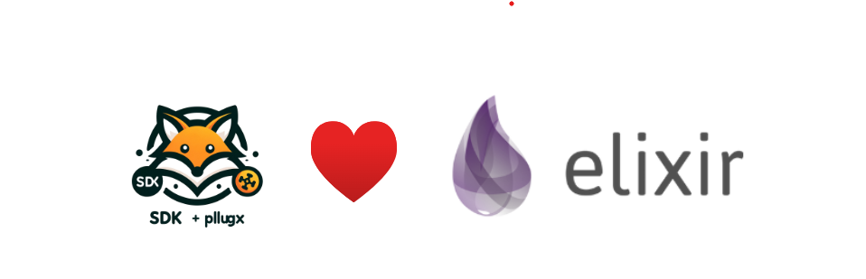

[中文](README_CN.md) | [English](README.md)

<div align="center">



[](https://github.com/version-fox/vfox-elixir/actions/workflows/lint.yml)
[](https://github.com/version-fox/vfox-elixir/actions/workflows/test.yml)
[](https://github.com/version-fox/vfox-elixir/actions/workflows/license.yml)
[](https://github.com/version-fox/vfox-elixir/actions/workflows/e2e.yml)
[](https://github.com/version-fox/vfox-elixir/actions/workflows/mise_e2e_test.yaml)

</div>

# vfox-elixir plugin

A [vfox](https://vfox.dev/) plugin for Elixir. It installs and switches between Elixir versions on Linux, macOS and Windows. The plugin does not install Erlang/OTP, which Elixir needs; see [Before you install](#before-you-install).

## Before you install

Elixir runs on Erlang/OTP, which the plugin does not install for you. Install an Erlang/OTP version that Elixir supports first, see [Erlang/OTP](docs/erlang.md).

```bash
vfox add erlang
vfox install erlang@26.2.3
vfox use -g erlang@26.2.3
```

## Usage

```bash
# install the plugin
vfox add elixir

# list the versions you can install
vfox search elixir

# install and select a version
vfox install elixir@1.16.2
vfox use -g elixir@1.16.2
elixir --version
```

Linux and macOS build Elixir from source with `make`. On Windows, the plugin runs the official installer, and the names end in the OTP version, such as `1.16.2-elixir-otp-26`. See [platforms.md](docs/platforms.md) for the requirements of each platform, and [versions.md](docs/versions.md) for the names.

## Windows

```powershell
vfox add erlang
vfox install erlang@26.2.3
vfox use -g erlang@26.2.3
vfox add elixir
vfox install elixir@1.16.2-elixir-otp-26
vfox use -g elixir@1.16.2-elixir-otp-26
```

Windows needs vfox 0.5.3 or later. Versions before 1.15 are not listed for Windows. See [platforms.md](docs/platforms.md#windows).

## Hex prebuilt packages

With `VFOX_ELIXIR_MIRROR=hex`, Linux and macOS install prebuilt Elixir from builds.hex.pm instead of compiling it. `vfox search elixir hex` lists those builds. Windows does not support them. See [mirror.md](docs/mirror.md).

```bash
vfox search elixir hex
VFOX_ELIXIR_MIRROR=hex vfox install elixir@1.16.2-otp-26
```

## Elixir already on the machine

`vfox link --detect elixir` links an Elixir that is already installed, from asdf, mise, Homebrew, Scoop, the system or the official installer, instead of installing another copy. It needs vfox 1.1.0 or later. See [link.md](docs/link.md).

## Usage with mise

The plugin can also be used with [mise](https://mise.jdx.dev/), a development tool manager:

```shell
# Elixir need Erlang/OTP, so install Erlang/OTP first
mise install vfox:version-fox/vfox-erlang@26.2.3
mise use -g vfox:version-fox/vfox-erlang@26.2.3

# Install an available version
mise install vfox:version-fox/vfox-elixir@1.16.2
```

## Documentation

**Using the plugin**

- [Versions and names](docs/versions.md): how to write a version, and how the names of installed versions are chosen
- [Platforms](docs/platforms.md): the install method, requirements and limits of Linux, macOS and Windows
- [Erlang/OTP](docs/erlang.md): the versions to pick, how the plugin finds `erlc`, and installing Erlang/OTP with vfox-erlang
- [Hex prebuilt packages](docs/mirror.md): installing Elixir from builds.hex.pm with `VFOX_ELIXIR_MIRROR=hex`
- [Elixir already on the machine](docs/link.md): adopting an Elixir that is installed elsewhere with `vfox link --detect elixir`
- [Troubleshooting](docs/troubleshooting.md): the messages the plugin prints and what to do about them
- [Changes](docs/changes.md): what each release changed

**Working on the plugin**

- [Install from source](docs/install-from-source.md): trying `main` before the next release
- [Development](docs/development.md): how the plugin works, how to change it, and how to release it
- [E2E tests](docs/e2e.md): the end-to-end tests on Linux, macOS and Windows

## Releasing this plugin

Maintainers can publish from **Actions → Plugin → Run workflow** on the default
branch by entering a stable plugin version without the `v` prefix. The shared
workflow updates `metadata.lua`, creates the version commit and tag, and publishes
the ZIP and manifest in this repository. No local tag or extra release token is
needed. Pull requests run checks only.

Existing version-tag pushes are supported when `PLUGIN.version` already matches
the tag. If publication fails, re-run the original failed job to resume it.

The workflow follows the shared `@v1` release-tool version. Updating the tool does
not release this plugin. See the [shared workflow documentation](https://github.com/version-fox/plugin-manifest-action)
for the package contract and first-rollout requirements.

## Documentation website

[中文](https://version-fox.github.io/vfox-elixir/) · [English](https://version-fox.github.io/vfox-elixir/en/)

The bilingual site is maintained under `website/`. See [website/README.md](website/README.md) for local build and deployment instructions.

## License

Apache 2.0. See [LICENSE](LICENSE).
