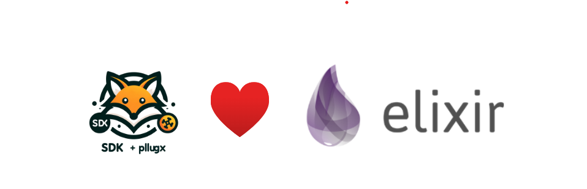

[中文](README_CN.md) | [English](README.md)

<div align="center">



[](https://github.com/version-fox/vfox-elixir/actions/workflows/lint.yml)
[](https://github.com/version-fox/vfox-elixir/actions/workflows/test.yml)
[](https://github.com/version-fox/vfox-elixir/actions/workflows/license.yml)
[](https://github.com/version-fox/vfox-elixir/actions/workflows/e2e.yml)
[](https://github.com/version-fox/vfox-elixir/actions/workflows/mise_e2e_test.yaml)

</div>

# vfox-elixir 插件

[vfox](https://vfox.dev/) 的 Elixir 插件。它可以在 Linux、macOS 和 Windows 上安装并切换 Elixir 版本，并管理每个版本所需的 Erlang/OTP。

## 安装前的准备

Elixir 运行在 Erlang/OTP 上，而插件不会替你安装它。请先安装一个 Elixir 支持的 Erlang/OTP 版本，见 [Erlang/OTP](docs/zh-CN/erlang.md)。

```bash
vfox add erlang
vfox install erlang@26.2.3
vfox use -g erlang@26.2.3
```

## 使用

```bash
# 添加插件
vfox add elixir

# 列出可以安装的版本
vfox search elixir

# 安装并选中一个版本
vfox install elixir@1.16.2
vfox use -g elixir@1.16.2
elixir --version
```

Linux 和 macOS 用 `make` 从源码构建 Elixir。在 Windows 上，插件运行官方安装器，版本名以 OTP 版本结尾，例如 `1.16.2-elixir-otp-26`。各平台的要求见 [平台](docs/zh-CN/platforms.md)，版本名的规则见 [版本与命名](docs/zh-CN/versions.md)。

## Windows

```powershell
vfox add erlang
vfox install erlang@26.2.3
vfox use -g erlang@26.2.3
vfox add elixir
vfox install elixir@1.16.2-elixir-otp-26
vfox use -g elixir@1.16.2-elixir-otp-26
```

Windows 需要 vfox 0.5.3 或更高版本。Windows 的版本列表不包含 1.15 之前的版本。见 [平台](docs/zh-CN/platforms.md#windows)。

## Hex 预编译包

设置 `VFOX_ELIXIR_MIRROR=hex` 后，Linux 和 macOS 会从 builds.hex.pm 安装预编译的 Elixir，而不是编译它。`vfox search elixir hex` 会列出这些构建。Windows 不支持它们。见 [Hex 预编译包](docs/zh-CN/mirror.md)。

```bash
vfox search elixir hex
VFOX_ELIXIR_MIRROR=hex vfox install elixir@1.16.2-otp-26
```

## 本机已有的 Elixir

`vfox link --detect elixir` 会链接已经装在本机的 Elixir（来自 asdf、mise、Homebrew、Scoop、系统或官方安装器），而不再安装一份。需要 vfox 1.1.0 或更高版本。见 [使用本机已有的 Elixir](docs/zh-CN/link.md)。

## 与 mise 一起使用

插件也可以与 [mise](https://mise.jdx.dev/) 一起使用。mise 是一个开发工具管理器：

```shell
# Elixir 需要 Erlang/OTP，所以先安装 Erlang/OTP
mise install vfox:version-fox/vfox-erlang@26.2.3
mise use -g vfox:version-fox/vfox-erlang@26.2.3

# 安装一个可用的版本
mise install vfox:version-fox/vfox-elixir@1.16.2
```

## 文档

**使用插件**

- [版本与命名](docs/zh-CN/versions.md)：怎样写版本，以及已安装版本的名字如何选择
- [平台](docs/zh-CN/platforms.md)：Linux、macOS 和 Windows 的安装方式、要求和限制
- [Erlang/OTP](docs/zh-CN/erlang.md)：要选的版本、插件怎样找到 `erlc`，以及用 vfox-erlang 安装 Erlang/OTP
- [Hex 预编译包](docs/zh-CN/mirror.md)：用 `VFOX_ELIXIR_MIRROR=hex` 从 builds.hex.pm 安装 Elixir
- [使用本机已有的 Elixir](docs/zh-CN/link.md)：用 `vfox link --detect elixir` 采用装在其他地方的 Elixir
- [问题排查](docs/zh-CN/troubleshooting.md)：插件输出的各种信息，以及怎样处理
- [变更记录](docs/zh-CN/changes.md)：每个版本改了什么

**参与开发**

- [从源码安装](docs/zh-CN/install-from-source.md)：在下一个版本发布之前使用 `main`
- [开发](docs/zh-CN/development.md)：插件的工作方式、修改方法和发布流程
- [E2E 测试](docs/zh-CN/e2e.md)：在 Linux、macOS 和 Windows 上运行的端到端测试

## 发布插件

维护者可以在默认分支上运行 **Actions → Plugin → Run workflow**，输入不带 `v` 前缀的稳定插件版本号来发布。共享的工作流会更新 `metadata.lua`、创建版本提交和标签，并在本仓库发布 ZIP 与 manifest。不需要本地打标签，也不需要额外的发布令牌。Pull Request 只运行检查，PR 标题不再触发发布。

当 `PLUGIN.version` 已与标签一致时，推送版本标签也可以发布。发布失败时，重新运行原来失败的任务即可继续。

工作流使用共享的 `@v1` 发布工具版本。更新该工具不会发布本插件。打包约定和首次上线的要求，见[共享工作流的文档](https://github.com/version-fox/plugin-manifest-action)。

## 文档网站

[中文](https://version-fox.github.io/vfox-elixir/) · [English](https://version-fox.github.io/vfox-elixir/en/)

双语网站位于 `website/` 目录。本地构建和部署说明见 [website/README.md](website/README.md)。

## 许可证

Apache 2.0，见 [LICENSE](LICENSE)。
